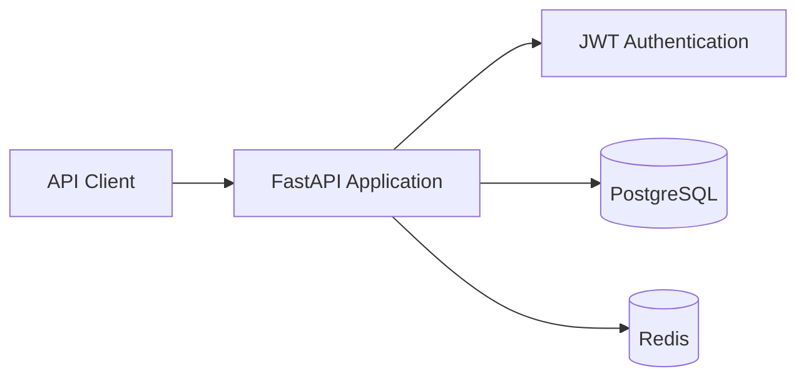

# FastAPI Production Starter

A compact, production-minded API starter for client projects that need authentication, PostgreSQL, Redis, Docker, and a tested FastAPI foundation.

> Portfolio Project — built to demonstrate backend architecture and delivery practices. It does not contain proprietary employer code.

## What it demonstrates

- Async FastAPI and SQLAlchemy 2.0
- PostgreSQL in production and isolated SQLite tests
- JWT access-token authentication with Argon2 password hashing
- Redis client lifecycle management
- Pydantic environment configuration
- Docker Compose health checks and persistent data volumes
- Centralized error handling and CORS configuration
- Automated API tests for registration, login, authorization, and conflicts

## Architecture



## Quick start with Docker

```bash
cp .env.example .env
docker compose up --build
```

Open:

- API documentation: http://localhost:8000/docs
- Health check: http://localhost:8000/api/v1/health

## Local development

Python 3.12 or newer is required.

```bash
python -m venv .venv
source .venv/bin/activate
python -m pip install -e '.[dev]'
cp .env.example .env
uvicorn app.main:app --reload
```

For local execution outside Docker, change `DATABASE_URL` and `REDIS_URL` in `.env` from the service names to `localhost`.

## Test

```bash
pytest
ruff check .
```

Tests use an in-memory SQLite database and never touch production data.

## API example

Register:

```bash
curl -X POST http://localhost:8000/api/v1/auth/register \
  -H 'Content-Type: application/json' \
  -d '{"email":"dev@example.com","full_name":"Demo Developer","password":"secure-pass"}'
```

Login:

```bash
curl -X POST http://localhost:8000/api/v1/auth/login \
  -H 'Content-Type: application/json' \
  -d '{"email":"dev@example.com","password":"secure-pass"}'
```

Use the returned token:

```bash
curl http://localhost:8000/api/v1/users/me \
  -H 'Authorization: Bearer YOUR_TOKEN'
```

## Production notes

- Generate a long random `JWT_SECRET`; never commit it.
- Run database migrations before starting the application.
- Terminate TLS at Nginx, a cloud load balancer, or another trusted reverse proxy.
- Restrict CORS origins to the deployed frontend domains.
- Add rate limiting and refresh-token rotation when required by the product threat model.

## Next improvements

- Alembic migration history
- Role-based permissions
- Refresh-token rotation and revocation
- Structured logging and OpenTelemetry
- CI workflow for linting, tests, and container builds

## License

MIT

